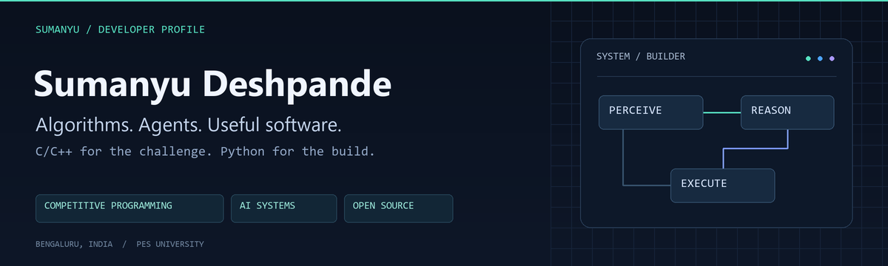

<p align="center">
  
</p>

<p align="center">
  <a href="https://www.linkedin.com/in/sumanyudeshpande/"></a>
  <a href="https://dice-website-omega.vercel.app/"></a>
  <a href="https://github.com/SumanyuDeshpande?tab=repositories"></a>
</p>

<p align="center">
  <a href="#about">About</a> · <a href="#featured-builds">Featured builds</a> · <a href="#toolkit">Toolkit</a> · <a href="#beyond-the-code">Beyond the code</a>
</p>

## About

I'm **Sumanyu**, a competitive programmer and software builder based in **Bengaluru, India**. I study at **PES University (2024–2028)** and founded **RENEWATT and GigabitMind**.

I enjoy the precision of **C/C++**, the practicality of **Python**, and the challenge of turning AI ideas into software people can use. My projects span desktop assistants, developer tools, privacy, and intelligent workflows.

```cpp
// Competitive programming mindset. Product-building curiosity.
while (curious) {
    learn();
    build();
    debug();
    iterate();
}
```

## Featured builds

| Project | What I'm building | Technical focus |
| :--- | :--- | :--- |
| **[DICE](https://github.com/SumanyuDeshpande/DICE)** | Direct Integrated Control Engine: a desktop AI assistant combining voice, screen understanding, gestures, and task execution. **[Explore →](https://dice-website-omega.vercel.app/)** | `Python` `OpenCV` `MediaPipe` `Vosk` `SQLite` |
| **[GBM · GigabitMind](https://github.com/SumanyuDeshpande/GBM)** | Automatic local project checkpointing and recovery, with file history and experiment sessions. | `Python` `CLI` `Developer tooling` |
| **[VSM Studio](https://github.com/SumanyuDeshpande/ValueStreamMapping-SCM-)** | An AI-powered value stream mapping workspace with a visual canvas, document Q&A, and current/future state comparisons. | `TypeScript` `React` `FastAPI` `LangChain` `ChromaDB` |
| **[Terms Guardian](https://github.com/SumanyuDeshpande/terms-guardian)** | A Chrome extension that turns privacy policies and terms into plain-English summaries with trust scores and flagged clauses. | `JavaScript` `Chrome Extensions` `Gemini` |

<details>
<summary><b>Explore more: energy systems, computer vision, and automation</b></summary>

<br />

- **[CORTEX-B](https://github.com/SumanyuDeshpande/CORTEX-B)** — a student smart battery management prototype with charge recommendations and comparative simulations. `Python` `NumPy` `Matplotlib`
- **[Computer Vision](https://github.com/SumanyuDeshpande/Computer_Vision)** — notebooks exploring computer vision from fundamentals to advanced topics. `Jupyter`
- **[Space-Cyber Watchdog](https://github.com/SumanyuDeshpande/Project-Space-Cyber-Watchdog-Real-time-Satellite-Log-Monitoring-n8n-)** — an n8n workflow for monitoring satellite logs and triggering rule-based anomaly alerts. `n8n` `JavaScript` `Webhooks`

</details>

## Toolkit

<p>
  
  
  
  
  
</p>

| Area | Tools used across my projects |
| :--- | :--- |
| **AI & perception** | OpenCV · MediaPipe · Vosk · Gemini · LangChain · ChromaDB |
| **Apps & interfaces** | React · FastAPI · Tkinter · Chrome Extensions |
| **Data & automation** | SQLite · NumPy · Matplotlib · n8n |

## Beyond the code

- **Noether Week winner · April 2026** — project presentation recognition for D.I.C.E., hosted by Q-Forest and IEEE Computer Society.
- **GirlScript Summer of Code · May 2026** — open-source contributor.
- **Developer communities** — Google Developer Group and NVIDIA Developer Program member.

<details>
<summary><b>Learning & credentials</b></summary>

<br />

- **Engineer AI Agents with Agent Development Kit (ADK)** — Google, July 2026.
- **Create Your First Gemini Enterprise Application** — Google, July 2026.
- **5-Day AI Agents Intensive Course with Google** — December 2025.

More about my background and credentials on **[LinkedIn](https://www.linkedin.com/in/sumanyudeshpande/)**.

</details>

---

<p align="center">
  Interested in <b>AI agents, developer tools, or open source</b>?<br />
  <a href="https://www.linkedin.com/in/sumanyudeshpande/">Let's connect</a> · <a href="https://github.com/SumanyuDeshpande/DICE/issues">Explore DICE issues</a> · <a href="https://github.com/SumanyuDeshpande?tab=repositories">Find a project to contribute to</a>
</p>
